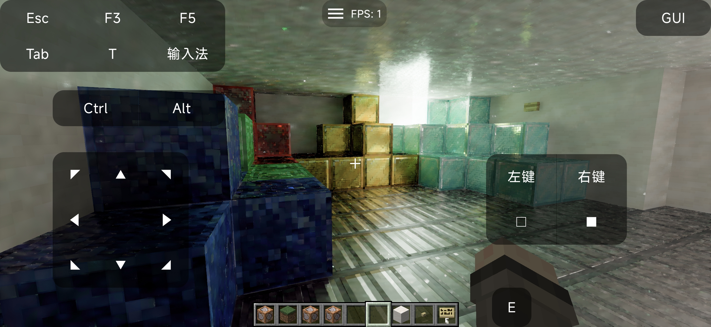

# Caustica for Mobile

Caustica for Mobile is an experimental ray-traced renderer for Minecraft 26.2's Vulkan backend.
It replaces the vanilla world view with hardware ray tracing, while keeping Minecraft's familiar UI and gameplay intact.

Caustica for Mobile is early software. Expect bugs, missing visual cases, and frequent
changes while the renderer is being built.



## Features

- Vulkan hardware path-traced world rendering
- Vendor-neutral reconstruction: DLSS Ray Reconstruction on NVIDIA, a built-in denoiser elsewhere
- DLSS Frame Generation support (experimental)
- HDR output
- Dynamic entity rendering in the ray-traced scene
- LabPBR-style material support
- ReSTIR PT spatiotemporal reuse of indirect path samples, on both traversal backends
- OMM (Opacity Micro-Map) + SER (Shader Execution Reordering) optimizations

## Requirements

- **Vulkan graphics backend enabled** — a launcher's "Vulkan"/Zink renderer is OpenGL over Vulkan and
  does not start Caustica; the game itself has to run on its Vulkan backend
- A GPU and driver with Vulkan ray tracing support (see below)
- HDR-capable display and OS HDR mode for HDR output
- On Linux, an HDR-capable Wayland compositor and a native Wayland session for HDR output
- Install LabPBR resource pack like [SPBR](https://modrinth.com/resourcepack/spbr) for better visuals

### Device support

Required extensions — without any of these the renderer stays off and the log says which one is missing:

| Extension | Why |
| --- | --- |
| `VK_KHR_acceleration_structure` | The BLAS/TLAS the whole renderer traces |
| `VK_KHR_deferred_host_operations` | Required by the acceleration-structure extension |
| `VK_KHR_ray_query` | The traversal itself (both the world pass and the block-outline occlusion test) |
| `VK_KHR_ray_tracing_position_fetch` | Hit triangle vertex positions, which is what builds the LabPBR normal-map TBN |

Required features (not extension names): `shaderInt64`, `bufferDeviceAddress`, `runtimeDescriptorArray`,
`shaderSampledImageArrayNonUniformIndexing`, `descriptorBindingPartiallyBound`,
`descriptorBindingSampledImageUpdateAfterBind`, `accelerationStructure`, `rayQuery`,
`rayTracingPositionFetch`, plus `shaderFloat16`/`shaderInt16`, which the world shaders' SPIR-V declares.

Everything else is used when present and costs only the feature it names when absent:

| Extension | What is lost without it |
| --- | --- |
| `VK_KHR_ray_tracing_pipeline` | The SBT traversal; the world pass falls back to ray query |
| `VK_EXT_ray_tracing_invocation_reorder` | EXT SER reordering (ray-tracing pipeline only, and it also needs LWJGL bindings new enough to name the feature) |
| `VK_EXT_opacity_micromap` | Hardware opacity micromaps for cutout foliage (ray-tracing pipeline only) |
| `VK_KHR_compute_shader_derivatives` | NRD's REBLUR; the NRD backend then runs RELAX, which needs no quad operations |
| `VK_KHR_get_memory_requirements2`, `VK_KHR_dedicated_allocation` | FSR upscaling; the built-in resolve is used instead |
| `VK_NV_low_latency2` (+ `VK_KHR_present_id`) | Reflex latency markers, NVIDIA only |
| `VK_NVX_binary_import`, `VK_NVX_image_view_handle` | The DLSS runtime, NVIDIA only |
| `VK_EXT_device_fault` | Driver fault details on device loss (diagnostics, opt-in) |

The NRD shim additionally needs `shaderStorageImageWriteWithoutFormat` and `shaderStorageImageReadWithoutFormat`
for NRD's own storage images.

## Traversal backends

The world pass traces the scene with whichever traversal the device offers, chosen once at device
creation:

- **Ray-tracing pipeline** (`VK_KHR_ray_tracing_pipeline`, preferred where present): raygen, closest-hit,
  any-hit and miss stages dispatched through a shader binding table, with optional EXT SER reordering and
  opacity micromaps.
- **Ray query** (`VK_KHR_ray_query`): the same passes run as compute, one thread per pixel, with the
  inline traversal emulating the any-hit records with a candidate loop. This is the path for devices that
  expose ray queries without a ray-tracing pipeline, such as Qualcomm Adreno GPUs.

Both backends trace the same acceleration structures and share every shader below the entry points, so
materials (including LabPBR roughness/metalness/F0/normal/SSS/emission, whose normal mapping needs
`VK_KHR_ray_tracing_position_fetch`), sky, emitter lighting and denoising behave identically. Set
`traversal.backend = "ray-query"` in `config/caustica.toml` to force the inline backend on hardware that
could run either, for comparison.

## ReSTIR PT

When enabled, the indirect pass is resampled with ReSTIR PT (`shaders/pipelines/world/restir.slang`),
and every pixel's indirect radiance is produced by a reservoir instead of by a fresh path. The
implementation runs on both traversal backends: the ray-tracing pipeline dispatches
`restir_temporal.rgen` and `restir_spatial.rgen` as raygen stages, while the ray-query backend dispatches
the matching `restir_temporal_rq.comp` / `restir_spatial_rq.comp` compute entry points; both share the
same body, hit/miss code and acceleration structures.

The two passes are:

- **Temporal** — generate this frame's path samples and merge the previous frame's reservoir after
  reprojecting the primary surface, then write the base direct-lighting lanes.
- **Spatial** — optional; shift reservoirs from a random disk of neighbors, cap confidence, shade the
  survivor, add the resampled indirect radiance to the base lanes, and write this frame's history entry.

With the default `restir.spatial-samples = 0` only the temporal pass runs: it shades the reservoir and
writes history directly, so no scratch array, spatial dispatch or spatial shader module is needed.

The primary pass publishes the visible surface's position, normal, view direction, material and entity
motion into a 64 B record. Both reservoir passes read that record instead of tracing the camera ray again,
so the feature adds no extra primary-ray traversal to the frame.

Each reservoir stores a path sample split at its first indirect vertex `x2`. The sample keeps `x2`, the
event that leaves it (a BSDF continuation, a sun/emitter connection, or the sky), the radiance that event
delivers, and the target-function value for the pixel that owns it. Reuse keeps `x2` and the suffix
fixed, reconnects the pixel's own visible surface `x1` to it, and re-evaluates the BSDF at both ends plus
the reconnection Jacobian; a BSDF suffix reproduces the ordinary path tracer's throughput and texture
LOD, and a light suffix reuses the light sample's visibility. Direct lighting at `x1` stays ordinary
sun/emitter NEE and is not resampled.

The implementation is the biased GRIS variant: reservoirs are merged with their resampling weights but
without pairwise MIS, and a shifted BSDF suffix keeps the source sample's directional pdf. It is a
noise-for-bias trade, not a reference renderer. ReSTIR PT is opt-in: check **ReSTIR PT** in Video Settings
or set `restir.enabled = true` in `config/caustica.toml`; the ordinary per-pixel path tracer remains the
default. Dielectric, particle, exact-mirror and submerged primary paths are also handed to the ordinary
path tracer, so only opaque primary hits are resampled. The other settings in `config/caustica.toml` are
`restir.spatial-samples` (default 0 = temporal-only), `restir.spatial-radius-pixels` (default 12),
`restir.confidence-cap` (default 8), `restir.firefly-clamp` and `restir.temporal`. Each reservoir is
96 B. Temporal-only keeps a 96 B history array, the 64 B primary record and a 4 B valid mask per render
pixel (164 B/px) and shades directly in the temporal pass; setting `spatial-samples` above zero adds a
96 B scratch array, the spatial pass and its shader module (260 B/px total). The arrays are allocated on
the first frame after the feature is enabled. The two reservoir passes are the largest shaders in the
project (the ray-query temporal entry inlines the path tracer), so a mobile driver may take noticeably
longer to compile them or refuse them outright; temporal-only avoids loading the spatial shader, and the
option should stay off where even the temporal shader cannot compile.

Reservoir reuse validates the primary surface's position, normal and material, and spatial reuse excludes
specular first-lobe and sharp low-roughness light-connection samples: shifting those across a smooth
surface would spread one sun/sky highlight into a broad white patch. The hue-preserving
`restir.firefly-clamp` (a pre-exposed luminance ceiling, defaulting to 2) and the confidence cap bound
whatever a canonical or temporal sample still carries. Raising `restir.spatial-samples` or
`restir.spatial-radius-pixels` buys smoother indirect light at the cost of neighbor shifts; lowering them
localizes reuse.

Emitter NEE (`lights.ris-candidates`) draws a power-weighted set of light candidates per shading point,
which on a mobile GPU is the largest single cost of the path pass. `lights.temporal` (default on) carries one
emitter sample per pixel across frames instead: the ordinary indirect pass keeps a 64 B record of the last
selected sample in camera-relative space, re-evaluates it at the new shading point, and merges it with one
fresh candidate before the single shadow ray. It is the same biased GRIS merge the ReSTIR path uses (no
pairwise MIS). The history is cleared on a material epoch or when the published light count changes, so a
removed emitter cannot keep shading; `lights.ris-candidates` still controls the fresh candidate count, with
a nonzero value required for emitter sampling itself.

Reconstruction is selectable in Video Settings. `auto` uses DLSS Ray Reconstruction where NGX can run,
then the NRD denoiser when its native library is present, then the built-in denoiser. The built-in denoiser
has no temporal history, so it is softer and noisier than the temporal denoisers at the same sample count.
Turning reconstruction off traces at native resolution and shows the raw path-traced image.

NRD (NVIDIA Real-time Denoisers) is a vendor-neutral compute denoiser used on devices that cannot run DLSS.
It is reached through the `caustica_nrd` native shim, which is built from `native/nrd_shim` and is not part
of the mod jar by default: build it, then put `libcaustica_nrd.so` (or `caustica_nrd.dll`) in `run/natives/`
or point `-Dcaustica.nrd.path` at it. `native/nrd_shim/build_cross.sh` builds the same shim for arm64 Linux
and arm64 Android, and `gradle bundleNrdNatives` packages whichever builds exist. Without it the built-in
denoiser is used instead. NRD is proprietary NVIDIA software; see `THIRD_PARTY_NOTICES.md`.

Which NRD denoiser runs is chosen from what the device can host: REBLUR where
`VK_KHR_compute_shader_derivatives` is available, and RELAX — whose passes issue no quad operations — where
it is not, which is the case on Adreno. The two differ only in how the front end encodes a lane's hit
distance, so the rendered result is the same kind of image either way.

The built-in denoiser and the NRD backend resolve to display resolution with a bilinear filter unless an
upscaler is selected. The Super Resolution Method option offers FSR (an AMD FidelityFX Vulkan runtime, when
one is present) and SGSR2 (Qualcomm's Snapdragon Game Super Resolution 2, a pure-compute temporal upscaler
that needs no native runtime, so it is what `auto` picks on platforms FSR does not cover — including arm64
and mobile GPUs). `amd_fidelityfx_vk.dll` is the runtime on Windows; the FidelityFX SDK's Vulkan
backend is a Windows build, so Linux has no `libamd_fidelityfx_vk.so` unless one is built from the SDK
sources and placed in `run/natives/`, the game directory, or `-Dcaustica.fsr.path`. Without it both `auto`
and an explicit FSR selection land on SGSR2, and the log says which method was chosen.

## Building

```sh
# Mod jar. NRD natives are bundled when native/nrd_shim has been built (see its README).
./gradlew build -x bundleNgxNatives

# Full build with the NVIDIA DLSS/NGX natives, needs the DLSS SDK:
DLSS_SDK=/path/to/DLSS ./gradlew build
```

The jar lands in `build/libs/`. Skipping `bundleNgxNatives` only leaves the DLSS runtime out of the jar:
DLSS features report themselves unavailable and reconstruction falls back to NRD or the built-in denoiser.

## Installation

1. Install Fabric Loader for Minecraft `26.2`.
2. Install Fabric API.
3. Put the Caustica jar in your Minecraft `mods` folder.
4. Launch the game with the Vulkan graphics backend.
5. Open Video Settings to adjust Caustica's renderer options.

## Usage Notes

- Caustica is client-side only.
- DLSS Ray Reconstruction and Frame Generation require supported NVIDIA
  hardware and drivers.
- Frame Generation is experimental and needs to be enabled by modifying the configuration file.
- HDR output requires an HDR swapchain and a correctly configured HDR display.
- When HDR is enabled on Linux, Caustica selects GLFW's native Wayland backend automatically. X11/XWayland surfaces generally do not expose the required HDR10/PQ format.
- If Minecraft falls back to OpenGL after a crash, re-enable the Vulkan backend
  before using Caustica again.
- **Video Settings → Reset Caustica Settings** restores every option to its default and
  rewrites `config/caustica.toml` with the comments a first launch writes. Most options apply
  immediately; settings fixed at startup (traversal backend, OMM, worker threads, capacities)
  take effect on the next launch. A `-Dcaustica.*` override still wins over the restored value.

### Java arguments

The desktop tuning set is
`-XX:+UseCompactObjectHeaders -XX:+AlwaysPreTouch -XX:+UseStringDeduplication -XX:+UseZGC`.
`UseCompactObjectHeaders` is a product flag only since Java 25; on Java 24 it needs
`-XX:+UnlockExperimentalVMOptions`, and older runtimes do not know it at all.

On Android launchers (Zalith Launcher, PojavLauncher and forks) that whole set can end the
process before Minecraft writes anything, which looks like an instant crash with no log
window:

- An option the bundled JRE does not know ends the JVM with
  `Unrecognized VM option '…' / Error: Could not create the Java Virtual Machine.` — there is
  no game log yet at that point.
- `-XX:+AlwaysPreTouch` touches the entire `-Xmx` heap during startup, which a phone's
  low-memory killer can answer by killing the process outright.
- `-XX:+UseZGC` needs a JRE built with ZGC and enough free RAM for its reserved heap;
  `-XX:+UseStringDeduplication` does nothing under ZGC (it belongs with G1, the default).

Start from `-Xmx2048M` alone (raise it only if the device has RAM to spare), confirm the game
reaches the title screen, then add one flag at a time to find the one the device rejects.
Keep `-Xss2M` only if the renderer reports a stack overflow at startup — it costs 2 MB of
stack per thread, and on Android a JRE whose own limit is already higher does not need it.

Bundled natives (the NRD shim) are unpacked into the app's own storage on Android, not next to the
game: the platform's linker only opens libraries inside the app's namespace, so a copy under
`/storage/emulated/0/...` is refused even when the device could run it.

### Profiling a frame

`[frame-stats]` in `config/caustica.toml` turns on the two halves of frame timing, both off by default:

- `enabled` times the CPU side of every stage, logs a line for any frame slower than 1.5× the rolling
  median, and writes `rt-frame-stats/frame.csv`.
- `gpu` reads timestamp queries back from the device and logs the **executed** GPU time per stage every
  couple of seconds (path trace, TLAS build, NRD front end/core/back end, each SGSR2 pass, exposure,
  bloom, display map, copy), plus `rt-frame-stats/gpu.csv` for the per-frame rows.

The GPU half is what tells a GPU-bound pass apart from one that merely records slowly; a stage shown in
both is the nested breakdown, not additional cost. It is also switchable in Video Settings as **Frame
Profiling**, which avoids editing the file on devices where that is awkward. With either option on, every
few seconds also produces a `Frame rate: … fps …` line that states whether RT actually composited the frame
(`rtComposite=`) alongside the render/display resolution, so a slow report taken with RT switched off is
still readable. Every run additionally logs the effective configuration it is rendering with
(`RT effective settings: …`), including the render resolution and the reconstruction backends that the
configured `auto` values resolved to.

## Compatibility

Caustica takes over the world renderer, so other mods that heavily modify world
rendering, shader pipelines, post-processing, or the Vulkan backend may conflict.
UI-only mods are more likely to work.

## Status

Caustica is not a finished renderer yet. Current work focuses on visual
correctness, world coverage, stability, and making the SDR/HDR presentation
paths behave consistently.

## License

Caustica's project-owned source code and documentation are licensed under the
GNU Lesser General Public License v3.0 or later. See [LICENSE.md](LICENSE.md),
[COPYING](COPYING), and [COPYING.LESSER](COPYING.LESSER).

Release artifacts may bundle NVIDIA DLSS/NGX SDK components under NVIDIA's own
license terms. See [THIRD_PARTY_NOTICES.md](THIRD_PARTY_NOTICES.md).

## TODO List

- [ ] Nether/End sky, weather, volumetric fog/clouds
- [ ] LOD
- [x] ReSTIR PT

## Special Thanks

[ComfyFluffy](https://github.com/ComfyFluffy), for the original [Caustica](https://github.com/ComfyFluffy/Caustica) mod.
[Tyuwwe](https://github.com/Tyuwwe/), for the implementation of SGSR2.
[tauray](https://github.com/vga-group/tauray) (LGPL-2.1), consulted as a reference for ReSTIR PT; no tauray source is included.